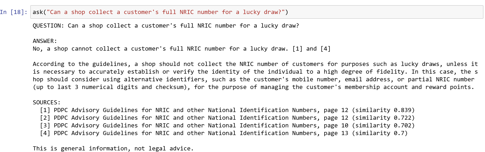

# PDPA Compliance Assistant (RAG)

A retrieval-augmented generation (RAG) assistant that answers questions about Singapore's **Personal Data Protection Act (PDPA)** using only official PDPC documents, and cites the document and page for every answer.



## Why this matters

Personal information shared or exposed online can be misused. Singapore's new Online Safety Commission received more than 500 reports of online harm in its first two months of operation (29 June to 31 August 2026), and **doxxing** (publishing someone's personal details to harass them) was the most reported harm, at 44% of eligible reports; the youngest victim was seven years old ([Malay Mail, citing CNA, 22 Sep 2026](https://www.malaymail.com/news/singapore/2026/09/22/singapore-online-safety-commission-gets-500-plus-reports-in-first-two-months-youngest-victim-seven/236090)). The PDPC also publishes guidance urging individuals to [share their personal data with care](https://www.pdpc.gov.sg/individuals/resources-tips/share-your-personal-data-with-care).

Doxxing itself falls under Singapore's online safety laws, but it shows why it matters to know what personal data may be collected, shared and protected. The PDPA sets those rules for organisations, yet its guidance runs to hundreds of pages. This project explores how AI can make those rules quicker to look up, while keeping every answer traceable to its official source.

## Why RAG?

A search engine returns links of mixed quality; a general AI chatbot answers from its training data, which may be outdated or from another country. A RAG assistant answers **only from an approved set of documents**, so an organisation gets:

- **Verifiable answers:** every answer cites the document and page.
- **Consistency:** every user gets answers from the same, current versions of the rules.
- **Safe refusals:** questions the documents don't cover are refused instead of guessed.
- **Privacy:** it runs locally, so internal policies could be added without uploading them to an outside service.

The same approach works for any rule-heavy domain, such as HR policies, MAS regulations or internal procedures.

## Documents used

5 official documents, **407 pages (about 3.6 MB)**, downloaded on 7 November 2026.

| Document | Pages | Source |
|---|---|---|
| Personal Data Protection Act 2012 | 125 | [Singapore Statutes Online](https://sso.agc.gov.sg/Act/PDPA2012?WholeDoc=1) |
| Advisory Guidelines on Key Concepts in the PDPA | 165 | [PDPC](https://www.pdpc.gov.sg/organisations/regulations-decisions/regulatory-guidance/advisory-guidelines-on-key-concepts-in-the-personal-data-protection-act) |
| Guide on Managing and Notifying Data Breaches | 40 | [PDPC](https://www.pdpc.gov.sg/organisations/resources/guidance-by-topic/data-breach-management-guide) |
| Advisory Guidelines for NRIC and other National Identification Numbers | 15 | [PDPC](https://www.pdpc.gov.sg/guidelines-and-consultation/2020/02/advisory-guidelines-on-the-personal-data-protection-act-for-nric-and-other-national-identification-numbers) |
| Advisory Guidelines on the PDPA for Selected Topics | 62 | [PDPC](https://www.pdpc.gov.sg/organisations/regulations-decisions/regulatory-guidance/advisory-guidelines-on-the-personal-data-protection-act-for-selected-topics) |

The PDFs are not included in this repository; file names and links are listed in `data/sources.csv`.

## How it works

```
PREPARE (once)
  5 PDFs ─► extract text per page ─► split into ~300-word chunks (50-word overlap, page number kept)
        ─► embed each chunk (nomic-embed-text, 768 numbers) ─► save as a NumPy matrix

ANSWER (per question)
  question ─► embed ─► cosine similarity with every chunk ─► top 4 chunks
           ─► best match below 0.69? ─► yes: refuse (no AI call)
                                     └► no: prompt = rules + chunks + question ─► llama3.2 answers
           ─► show answer + sources (document, page) + disclaimer
```

1. **Load:** read each PDF page by page with `pypdf` and clean the text.
2. **Chunk:** split pages into overlapping ~300-word pieces, keeping the page number for citations.
3. **Embed:** turn each chunk into a vector that represents its meaning (`nomic-embed-text` via Ollama).
4. **Retrieve:** embed the question and find the 4 most similar chunks with cosine similarity (NumPy).
5. **Refuse or answer:** if no chunk is similar enough, refuse; otherwise the model answers using only the retrieved chunks.
6. **Evaluate:** score retrieval, refusals and answers on a hand-checked test set.

**Stack:** Python, pypdf, NumPy, Ollama (`nomic-embed-text`, `llama3.2`), Jupyter. Runs fully on a laptop.

## Results

Tested on **30 hand-checked questions** (25 PDPA + 5 off-topic):

| Test | Result |
|---|---|
| Correct page retrieved (top 4 chunks) | **24 of 25 (96%)** |
| Off-topic questions refused cleanly | **5 of 5** (up from 4 of 5 before the similarity threshold) |
| Answers containing the key fact | **18 of 25 (72%)** |

**Key findings**

- **Search by meaning works:** a question about a "data leak" found the data breach guide, which never uses the word "leak".
- **The threshold is data-driven:** every PDPA question scored at least 0.729 similarity and every off-topic question at most 0.648, so 0.69 sits in the gap.
- **Retrieval right, answer wrong:** the model said "72 hours" for breach notification although its retrieved source says **3 calendar days**. A prompt rule to copy figures exactly did not fix it, which points to the small model's limits. This is why every answer shows its sources.

## How to run it

1. Install [Ollama](https://ollama.com) and run `ollama pull nomic-embed-text` and `ollama pull llama3.2`.
2. Download the PDFs from the links above into a `documents/` folder, using the file names in `data/sources.csv`.
3. Run `notebooks/pdpa_assistant.ipynb` to build the index and ask questions, then `notebooks/pdpa_score.ipynb` to reproduce the results.

## Project structure

```
pdpa-compliance-rag/
├── notebooks/
│   ├── pdpa_assistant.ipynb   # the assistant: load, chunk, embed, retrieve, answer
│   └── pdpa_score.ipynb       # evaluation: retrieval, refusals, answer accuracy
├── data/
│   ├── sources.csv            # official document titles, links, download dates
│   └── test_questions.csv     # hand-checked answer key (30 questions)
├── results/
│   ├── test_results_baseline.csv
│   └── test_results_improved.csv
├── assets/
│   └── screenshot.png
├── requirements.txt
└── README.md
```

## Limitations

- General information only, **not legal advice**.
- The small local model misses the key fact in about 1 in 4 answers; check the cited page.
- The threshold was tuned on the same 30 questions it was tested on.

## Future work

1. **Larger model:** test `llama3.1:8b` on the same questions to reduce answer errors.
2. **Better retrieval:** add `nomic-embed-text`'s query/document prefixes and keyword search.
3. **Web app:** a Streamlit interface with a public demo link.

## Disclaimer

- This is a **personal learning and portfolio project**, built only from **publicly available** official documents and news reports, cited above.
- It is **not legal advice** and must not be relied on for compliance decisions. Always refer to the official sources or seek professional legal advice.
- It is **not affiliated with, or endorsed by,** the Personal Data Protection Commission (PDPC) or any Singapore Government agency.
- **No personal data** was collected or used. Test questions use general, fictional scenarios.
- The source documents remain the property of their publishers and are not redistributed here.
